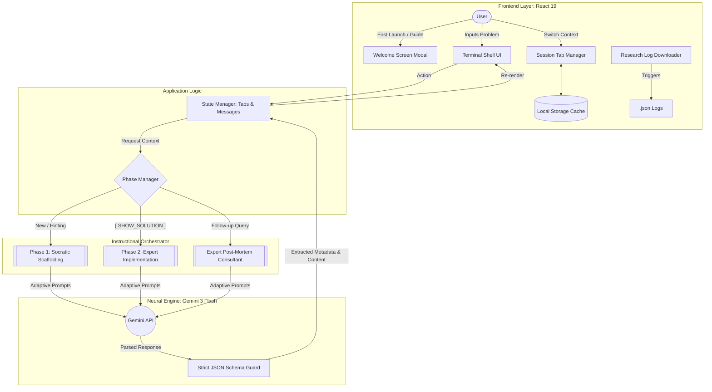

# HintFlow 📝

**HintFlow** is an AI-powered Socratic coding tutor designed specifically for computer science students and research analysis. Instead of providing immediate solutions, HintFlow guides users through programming problems using progressive scaffolding, high-depth technical analysis, and data-rich interactions.

## ✨ Features

- **Unix Terminal Aesthetic**: A professionally crafted, high-contrast UI inspired by classic shell environments and `tmux` multiplexers, using **Fira Code** for all typography.
- **Interactive Animated Welcome Screen**: A boot screen modal powered by Framer Motion with feature breakdowns, configuration toggles, and click-to-load sample prompts (Two Sum, LRU Cache, Valid Parentheses, Binary Search).
- **Automatic Browser Cache Persistence**: Stores all active session tabs, message histories, visible hint progression, and user preferences in `localStorage` so sessions persist across browser refreshes and tab closures.
- **Multi-Language Solution Suite**: Default golden-path solutions in **C, C++, and Python** in a tabbed code viewer, or targeted solutions for custom requested languages (Java, Rust, Go, TypeScript, etc.).
- **Phase-Based Retrieval (Lazy Loading)**: Implements a dual-phase execution model. Hints are generated instantly (Phase 1), while full solutions and deep-dives are fetched on demand (Phase 2).
- **Data-Rich Interactions (Research Mode)**: Automatically extracts metadata such as `topic_tags`, `difficulty_score`, and `technical_depth_score` for quantifiable learning analysis.
- **Socratic "Check for Understanding"**: Generates dynamic `reflective_questions` to force conceptual engagement before code disclosure.
- **Adaptive Scaffolding**: Analyzes user-provided code for specific logic errors and tailors the initial hint sequence to address those unique mistakes.
- **Expert Post-Mortem**: Once solved, HintFlow transitions into **Expert Implementation Mode**, providing high-depth technical analysis of memory management, performance trade-offs, and first-principles mechanics.
- **Complexity Analysis Card**: Dedicated UI for mandatory Time $O(...)$ and Space $O(...)$ complexity metrics.
- **Common Pitfalls**: Identifies frequent student bugs and edge cases specific to the problem.
- **Download Research Logs**: Integrated one-click JSON export of all session tabs, messages, and AI-extracted metadata for academic analysis and performance tracking.

## 🛠️ Tech Stack

- **Frontend**: React 19, TypeScript, Vite
- **AI Engine**: Google Gemini 3 Flash (via `@google/genai` TypeScript SDK)
- **Styling**: Tailwind CSS 4
- **Animations**: Motion (`motion/react`)
- **Icons**: Lucide React
- **Syntax Highlighting**: React Syntax Highlighter (Prism / VS Code Dark Plus)
- **Math Support**: Full LaTeX support for algorithmic expressions using KaTeX & remark-math / rehype-katex.

## 🚀 Getting Started

### Prerequisites

- [Node.js](https://nodejs.org/) (v18 or higher)
- [npm](https://www.npmjs.com/) (v9 or higher)
- A Google Gemini API Key (Get one at [Google AI Studio](https://aistudio.google.com/))

### Installation

1. **Clone or download** the repository.
2. **Install dependencies**:
   ```bash
   npm install
   ```
3. **Configure Environment**: Set `GEMINI_API_KEY` in your environment variables or a `.env` file.

### Running the App

```bash
npm run dev
```
The app will be available at `http://localhost:3000`.

## 📖 Interactive Workflow

1. **Welcome Screen & Quick Start**: Launch with animated guidance or pick a starter prompt (e.g. Two Sum, LRU Cache).
2. **Input Challenge**: Type your problem statement or code snippet at the `student@hintflow %` prompt. Mention a specific language if desired (e.g., *"in Java"*).
3. **Analyze Scaffolding**: Review the **Big Idea** and work through the progressive 4-tier hints.
4. **Solve Reflection**: Answer the `THINK_ABOUT_THIS` reflective question before unveiling the solution.
5. **Code Inspection**: Fetch the full solution. Toggle between multi-language solutions (C, C++, Python) and inspect the **Complexity Analysis** card.
6. **Local Persistence**: Work across multiple tabs (`tmux` multiplexer bar)—all state is automatically cached in your browser.
7. **Expert Follow-up**: Ask descriptive questions for a deep-dive post-mortem analysis.
8. **Export Logs**: Click the download icon to save full research logs as a structured JSON file.

## 🧠 Under the Hood

### System Architecture



### Instructional Modes
HintFlow utilizes a specialized state-machine for pedagogical delivery:

1. **HINT_MODE (Phase 1)**: Focuses on "Desirable Difficulty." It provides conceptual analogies, pseudocode strategies, minimal bottleneck snippets, and a "reflective question" to ensure the student builds a mental map before viewing code.
2. **SOLUTION_MODE (Phase 2)**: Triggered on-demand. Generates idiomatic, production-grade implementations (defaulting to C, C++, and Python, or specific requested languages) with trade-off analysis and common pitfalls.
3. **FOLLOWUP_MODE (Post-Mortem)**: Acts as an **Expert Implementation Consultant**. It answers "under the hood" questions regarding stack frames, memory management, compiler optimizations, and real-world engineering scenarios.

### Research & Data Quantification
To support technical publications and quantifiable analysis, every AI response includes research metrics:
- **`topic_tags`**: For domain difficulty analysis.
- **`difficulty_score` (1-10)**: Quantifies the cognitive load of a given problem.
- **`technical_depth_score` (1-5)**: Measures the complexity of expert follow-up responses.

#### 📊 Data Export (Research Logs)
The `[ DOWNLOAD_LOGS ]` button exports the full session state as a structured JSON file. This includes:
- **Global Metadata**: Device-agnostic timestamps and session identifiers.
- **Transcript Data**: Every user prompt vs. AI response sequence.
- **Extracted Metrics**: All cognitive load scores and topic tags for each interaction.
- **Complexity Analysis**: Captured Time/Space complexity data for solutions.

### Structured Response Schema
HintFlow leverages **STRICT JSON** enforcement to ensure the React frontend remains robust. The schema evolves based on the active phase:

**Phase 1 Response:**
```json
{
  "isRelevant": true,
  "topic_tags": ["Recursion", "Arrays"],
  "difficulty_score": 7,
  "overview": "Big Idea explanation...",
  "hints": ["Hint 1", "Hint 2", "Hint 3", "Hint 4"],
  "reflective_question": "Socratic CFU..."
}
```

**Phase 2 Response:**
```json
{
  "solutions": [
    { "language": "c", "code": "...code..." },
    { "language": "cpp", "code": "...code..." },
    { "language": "python", "code": "...code..." }
  ],
  "complexity": { "time": "O(n log n)", "space": "O(n)" },
  "explanation": "Deep dive text...",
  "pitfalls": ["Common bug 1", "Common bug 2"],
  "resources": {
    "books": [{ "title": "Introduction to Algorithms", "author": "Cormen et al." }],
    "websites": [{ "name": "GeeksforGeeks", "url": "https://geeksforgeeks.org" }]
  }
}
```

**Follow-up Response:**
```json
{
  "overview": "Direct expert answer...",
  "technical_depth_score": 4,
  "hints": []
}
```

## 📜 License

This project is licensed under the **Apache-2.0 License**.

---
*Built for the next generation of software engineers and researchers.*
