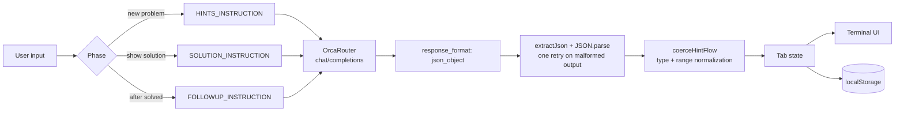

# HintFlow

**HintFlow** is a local-first Socratic tutor for coding problems. It reads a problem statement (or
your own attempt), returns a short sequence of progressively stronger hints, and only produces a
full implementation when you explicitly ask for one. Solutions come in **C, C++ and Python** by
default, or in whatever language you name.

There is no backend and no telemetry: the browser talks to the model API directly, and every session
is stored in `localStorage`.

---

## Features

- **Hints before answers.** A model-generated "big idea", then hints revealed one at a time, plus a
  `Think about this` question that has to be considered before the solution unlocks.
- **On-demand solutions.** `[ Show solution ]` fetches a tabbed C / C++ / Python viewer with a
  complexity card, common pitfalls, a deep-dive explanation and further reading.
- **Follow-up mode.** Once solved, the terminal switches to an expert consultant for questions about
  complexity, memory, or edge cases.
- **Light and dark themes.** A full second palette (not a CSS filter) with matching syntax themes —
  Atom One Dark and Atom One Light.
- **Adjustable text size.** 87.5% / 100% / 115% / 130%, scaling every text size in the UI.
- **Session tabs.** `tmux`-style tabs; each keeps its own transcript, hint progress and solved state.
- **Everything persists locally.** Tabs, active tab, theme, text size and the welcome-screen
  preference survive a refresh.
- **Research log export.** Downloads the whole session state as JSON.
- **Markdown and maths.** Answers render Markdown, fenced code and KaTeX.

---

## Tech stack

| Layer | Choice |
| --- | --- |
| UI | React 19, TypeScript, Vite 7 |
| Styling | Tailwind CSS 4 with CSS-variable design tokens |
| Animation | Motion (`motion/react`) |
| Icons | Lucide React |
| Highlighting | `react-syntax-highlighter` (Prism) — Atom One Dark / One Light |
| Markdown / maths | `react-markdown`, `remark-math`, `rehype-katex` |
| Model | `deepseek/deepseek-v4.1-flash-free` via OrcaRouter (OpenAI-compatible) |

---

## Getting started

### Prerequisites

- Node.js **20.19+** or **22.12+** (required by Vite 7)
- npm 9+
- An OrcaRouter API key — <https://api.orcarouter.ai>

### Install

```bash
npm install
```

`better-sqlite3` is an unused leftover dependency. On very new Node releases its native build can
fail and abort the install; run `npm install --ignore-scripts` in that case.

### Configure

Create `.env` in the project root:

```bash
VITE_ORCAROUTER_API_KEY="sk-orca-..."
```

Vite only exposes variables prefixed with `VITE_`, and they are **inlined into the client bundle**.
Treat this key as public: use a key with a spending limit, and never deploy a production build
publicly (see [Security](#security)).

### Run

```bash
npm run dev      # http://localhost:3000
```

Other scripts:

```bash
npm run lint     # tsc --noEmit
npm run build    # production build into dist/
npm run clean    # remove dist/
```

---

## Using it

1. Type a problem — or paste your attempt — at the `student@hintflow %` prompt.
2. Read the overview and reveal hints with `[ Reveal hint (n of m) ]`.
3. When the last hint is shown, `[ Show solution ]` becomes available.
4. Use the `LANG` tabs to switch between languages; `COPY CODE` copies the current one.
5. Ask follow-up questions in the same input once the solution is unlocked.
6. `[+]` opens a new session tab; the download icon exports the research log; the reset icon clears
   every tab.

### Controls

| Control | Location | Behavior |
| --- | --- | --- |
| Sun / moon | Terminal title bar and welcome screen | Toggles light and dark mode; saved to `localStorage` |
| `−` / `+` | Terminal title bar | Steps text size through 87.5% → 100% → 115% → 130%; saved |
| `?` | Title bar | Reopens the welcome screen |
| Download | Title bar | Exports all tabs as `hintflow_research_logs_<timestamp>.json` |
| Reset | Title bar | Replaces every tab with a fresh session — immediate, no confirmation |

---

## How it works

The app runs a three-phase state machine. Every phase is a single chat completion whose JSON contract
is described in the system prompt.

| Phase | Trigger | Thinking | Typical latency |
| --- | --- | --- | --- |
| **Hints** | New problem or code | enabled, `reasoning_effort: low` | ~5 s |
| **Solution** | `[ Show solution ]` | **disabled** | ~10 s |
| **Follow-up** | Message after solving | enabled, `reasoning_effort: high` | varies |

The solution phase deliberately disables reasoning. On this model, hidden reasoning tokens were the
dominant cost — measured 25–53 s with thinking versus 9–10 s without — and a code-transcription task
does not need them. Hints and follow-ups keep thinking because their quality depends on it.



### Why responses are coerced, not schema-validated

The client asks for `response_format: { type: "json_object" }`, not a strict JSON schema: OrcaRouter
documents schema support, but it varies per upstream model. `json_object` guarantees syntactically
valid JSON and nothing about its fields, so `coerceHintFlow` in `src/lib/llm.ts` normalizes every
field the UI indexes into — strings default to `""`, arrays are filtered, and scores are clamped
(`difficulty_score` 1–10, `technical_depth_score` 1–5). A partial model response degrades instead of
crashing the terminal. Malformed JSON is retried once before failing.

### Response contracts

**Hints**

```json
{
  "isRelevant": true,
  "topic_tags": ["Arrays", "Hash Map"],
  "difficulty_score": 3,
  "overview": "The big idea...",
  "hints": ["...", "...", "...", "..."],
  "reflective_question": "..."
}
```

**Solution**

```json
{
  "solutions": [
    { "language": "c", "code": "..." },
    { "language": "cpp", "code": "..." },
    { "language": "python", "code": "..." }
  ],
  "complexity": { "time": "O(n)", "space": "O(n)" },
  "explanation": "...",
  "pitfalls": ["..."],
  "resources": {
    "books": [{ "title": "...", "author": "..." }],
    "websites": [{ "name": "...", "url": "..." }]
  }
}
```

**Follow-up**

```json
{ "overview": "...", "technical_depth_score": 4, "hints": [] }
```

---

## Theming

Colours are CSS custom properties, not hardcoded utilities, so both palettes come from one markup
tree (`src/index.css`).

| Token | Dark | Light |
| --- | --- | --- |
| `--onyx` (page) | `#000000` | `#f5f5f2` |
| `--surface` (terminal) | `#0c0c0c` | `#fbfbf9` |
| `--chrome` (bars, chips) | `#1a1a1a` | `#e8e8e3` |
| `--titlebar` | `#2d2d2d` | `#dfdfd8` |
| `--line` | `#333333` | `#c6c6be` |
| `--accent` | `#00ff41` | `#067a2e` |

Three details make the light theme work rather than merely invert:

1. **The zinc ramp is inverted** under `html[data-theme="light"]`. The markup uses `zinc-400` for
   muted text and `zinc-800/900` for blocks, which only read correctly on a dark canvas.
2. **Warm accents darken** (amber, red, emerald, sky) to keep contrast on paper.
3. **Code snippets switch syntax theme** — Atom One Dark (`#282c34`) in dark mode, Atom One Light
   (`#fafafa`) in light mode — so tokens never land on a background they were not designed for.

Text size is a single `--fs` variable on `<html>`. Rem-based utilities scale with the root font size,
and fixed pixel sizes use `calc(9px * var(--fs))`.

A small inline script in `index.html` applies the stored theme and size before React mounts, so a
light-mode session does not flash dark on load.

---

## Project structure

```
index.html                       Shell, page title, pre-paint theme/size script
src/main.tsx                     React entry point
src/App.tsx                      Terminal UI, phase orchestration, prompts, persistence
src/components/WelcomeScreen.tsx Welcome screen with samples and theme toggle
src/lib/llm.ts                   OrcaRouter client, retry, response coercion
src/types.ts                     Shared response and tab types
src/index.css                    Design tokens, theme variants, scrollbars
vite.config.ts                   React + Tailwind plugins, path alias
```

`localStorage` keys: `hintflow_sessions_v1`, `hintflow_active_tab_v1`, `hintflow_show_welcome_v1`,
`hintflow_theme_v1`, `hintflow_font_scale_v1`.

---

## Security

The API key is inlined into the JavaScript bundle because the browser calls the API directly. That is
fine for local use and unacceptable for a public deployment — anyone can read the bundle and spend
your credits.

- Keep `.env` out of version control.
- Do not expose the dev server on all interfaces. `npm run dev` currently passes `--host=0.0.0.0`;
  bind it to `127.0.0.1` if you are not deliberately sharing it.
- `dist/` contains the key. Run `npm run clean` after building.
- Rotate the key if it has ever been shared or committed.

If you need a public deployment, move the call behind a server-side proxy with its own rate limiting
and per-user quota — the response contracts above are unchanged.

---

## Known limitations

- **Direct browser calls depend on CORS.** OrcaRouter answers preflights with
  `access-control-allow-origin: *`, which is what allows a backend-free design. A provider that does
  not would require a proxy.
- **Free-tier reliability.** Upstream quota and availability fluctuate; the terminal surfaces the
  provider's HTTP status and a retry prompt instead of failing silently.
- **No streaming.** A solution arrives as one payload (~10 s), not token by token.
- **No conversation window.** Each request carries the current prompt plus the problem context; long
  follow-up threads are not replayed in full.
- **Learner state is per browser.** Clearing site data clears every session.

---

## License

Apache-2.0.
